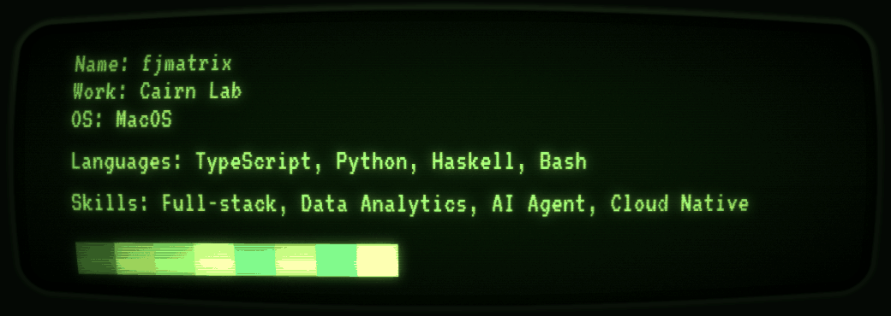

  

<!--
- 🚀 **Built and shipped:** [Flightcat](https://flightcat.io) and [Avenlight](https://avenlight.app), from idea to production.
- 🧠 **Interests:** AI agents, MCP, evals, behavioral analytics, and developer tools.
- 📍 **Based in:** Austin, Texas.
- 💬 **Connect:** [LinkedIn](https://www.linkedin.com/in/frankjia/)
-->

- **Cairn**: (early) Cairn is an AI agent for all your web, app, and marketing performance data. It explains what’s changing, uncovers what’s driving it, and recommends what to do next.

- **[Avenlight](https://avenlight.app)**: Behavioral analytics powered by multi-step AI agents to uncover conversion journeys, recurring patterns, and content effectiveness.

- **[Flightcat](https://flightcat.io)**: AI flight search for budget travels with range dates and broad destinations.

- **[Flight Search LLM Benchmark](https://github.com/fjmatrix/flight-search-intent-eval)**: LLM benchmark for flight-search intent parsing across 244 English, German, and Spanish queries, with 11 grading dimensions and a [model leaderboard](https://fjmatrix.github.io/flight-search-intent-eval/).
  

  

